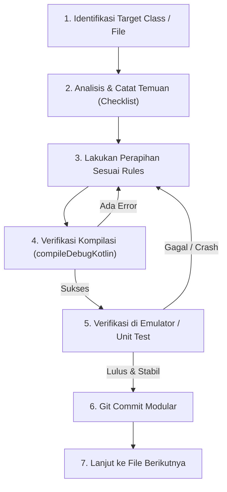

# SKILL_PERAPIAN_KODE — Playbook Perapihan & Refactoring Kode Android

Skill ini adalah panduan standar dan prosedur wajib bagi AI Assistant dan Developer dalam melakukan **refactoring, pembersihan kode (code tidying), modernisasi dependensi/toolchain, dan mitigasi bug struktural** pada aplikasi Android.

Seluruh aturan dalam panduan ini dikurasi secara spesifik dari rekam jejak investigasi bug, perbaikan runtime, dan standar kualitas kode proyek.

---

## 1. Golden Rules (Prinsip Utama Perapihan)

1. **Perilaku Bisnis Tetap Utuh (*Behavior Preservation*)**:
   - Refactoring merapikan arsitektur, meningkatkan performa, dan memperjelas keterbacaan kode **tanpa mengubah logika bisnis yang sudah benar**.
   - Setiap perbaikan bug logika harus dipisahkan atau didokumentasikan secara eksplisit.
2. **Satu Per Satu (*Step-by-Step Execution*)**:
   - Kerjakan perapihan secara modular per kelas atau per modul.
   - Selesaikan 1 perubahan → pastikan kompilasi sukses (`compileDebugKotlin`) → uji fungsionalitas → lakukan Git commit sebelum beralih ke kelas berikutnya.
3. **No Redundant Aliases & Clear Naming**:
   - Hapus variabel alias atau `typealias` kosong yang membingungkan.
   - Gunakan Bahasa Inggris yang ringkas, baku, dan konsisten dengan CamelCase.
4. **Strict Null Safety & Type Discipline**:
   - Hindari inisialisasi semu seperti string kosong `""` untuk representasi tanggal/waktu atau data nullable; gunakan `Date`/`Calendar` atau nullable types (`String? = null`).
5. **Zero Zombie Code**:
   - Bersihkan seluruh blok komentar kode lama (*commented-out code*), import tak terpakai, dan fungsi `private` yang tidak pernah dipanggil.

---

## 2. Aturan Rinci Perapihan Kode (Rules Catalog)

### A. Eliminasi Zombie Code & Komentar Mati (`zombie-code`)
- **Hapus Komentar Bekas Implementasi**: Hapus seluruh komentar kode non-aktif (`// val oldList = ...`, `/* function legacy() { ... } */`).
- **Pembersihan Import & Dead Members**:
  - Hapus import yang tidak digunakan (*unused imports*).
  - Hapus variabel, konstanta, atau fungsi `private` yang tidak memiliki referensi (`grep -rnw` = 0).
- **Pertahankan Komentar Fungsional**: Direktif kompilasi (`@Suppress`, `//noinspection`), header lisensi, atau catatan arsitektur penting tetap dipertahankan.

### B. Standardisasi Penamaan & Naming Convention (`naming`)
- **Bahasa Inggris & Naming Ringkas**:
  - Ubah penamaan kelas/variabel campuran atau bahasa Indonesia menjadi bahasa Inggris yang ringkas dan idiomatis.
  - *Contoh:* `DataPembayaranViewModel` → `PaymentViewModel`, `DataPembayaranRepository` → `PaymentRepository`.
- **Koreksi Typo Historis**:
  - Koreksi typo pada package/file legacy (misal `ArisanGorup` → `ArisanGroup`, `ArisanMemeber` → `ArisanMember`).
- **Konvensi Huruf (CamelCase)**:
  - PascalCase untuk `Class`, `Interface`, `Object`.
  - camelCase untuk properti, variabel, dan nama fungsi.
  - UPPER_SNAKE_CASE untuk konstanta `const val` di dalam `companion object`.

### C. Eliminasi Duplikasi & Typealias Kosong (`typealias-cleanup`)
- **Dilarang Menggunakan Typealias Kosong/Redundan**:
  - Hapus `typealias` yang hanya menunjuk langsung ke kelas database/entity lain tanpa abstraksi nilai tambah (contoh: `typealias DataModelPembayaranDB = PaymentDatabase`).
  - Ganti seluruh referensi kode yang memanggil typealias tersebut langsung ke nama kelas aslinya (`PaymentDatabase`).
- **Penghapusan Variabel Proxy Tak Perlu**:
  - Variabel penampung yang hanya me-referensi variabel lain tanpa transformasi harus di-inline atau dibersihkan.

### D. Tipe Data, Null Safety, & Inisialisasi Tanggal (`type-safety`)
- **Inisialisasi Tanggal & Waktu**:
  - Dilarang keras menginisialisasi string penampung tanggal dengan nilai kosong seperti `private var dateTimeNow: String = ""`.
  - Gunakan `String? = null` jika sifatnya nullable, atau gunakan representasi objek waktu yang valid (`Date`, `Calendar`, atau `java.time.*`).
- **Perbandingan Resource String**:
  - Jangan membandingkan teks resource dengan string ID integer secara keliru (hindari komparasi `getString(R.string.x) == "..."` jika yang dibandingkan adalah integer ID).
  - Pastikan konversi tipe data antara String, Integer, dan Double ditangani dengan safe parsing (`toIntOrNull() ?: 0`, `toDoubleOrNull() ?: 0.0`).

### E. Keamanan Lifecycle Android & Pencegahan ANR / Memory Leak (`lifecycle-safety`)
- **Android 12+ (API 31+) PendingIntent Safety**:
  - Setiap instansiasi `PendingIntent` wajib menyertakan flag mutabilitas eksplisit:
    ```kotlin
    PendingIntent.getActivity(
        context,
        requestCode,
        intent,
        PendingIntent.FLAG_UPDATE_CURRENT or PendingIntent.FLAG_IMMUTABLE
    )
    ```
- **Android 13+ (API 33+) Notification Permission**:
  - Wajib menyertakan permission `POST_NOTIFICATIONS` di `AndroidManifest.xml` dan menangani runtime permission check sebelum menembakkan notifikasi.
- **Pembersihan Observer LiveData**:
  - Observasi `LiveData` atau `StateFlow` hanya boleh dilakukan **satu kali** di dalam `onCreate` (Activity) atau `onViewCreated` (Fragment) dengan `viewLifecycleOwner`.
  - **Dilarang Keras** mendaftarkan observer berulang kali atau menempatkan instansiasi/re-attaching `RecyclerView.adapter` di dalam callback observer yang memicu memory leak atau jumping scroll.
- **Pencegahan Akumulasi Nilai Ganda (Chart / Counter Compounding)**:
  - Pada kelas seperti `HutangFragment` dan `PiutangFragment`, pastikan variabel akumulator/total atau entry grafik dibersihkan (`accumulator = 0`, `entries.clear()`) sebelum melakukan kalkulasi ulang pada siklus `onResume()` atau pembaruan data, agar nilai statistik tidak berlipat ganda (*compounding bug*).
- **Pencegahan Rekursi Tak Terbatas & Loop Listener**:
  - Periksa `onOptionsItemSelected` agar selalu memanggil `super.onOptionsItemSelected(item)` alih-alih memanggil `this.onOptionsItemSelected(item)` yang memicu `StackOverflowError`.
  - Pasang guard flag atau debouncing pada `TextWatcher` agar tidak memicu infinite trigger saat memformat input nominal mata uang.

### F. Integritas Resource & Kompatibilitas Multi-Bahasa (`resource-integrity`)
- **Validasi Sinkronisasi String Resource**:
  - Pastikan setiap key string yang ada di `values/strings.xml` tersedia di folder lokalisasi lainnya (`values-in`, `values-en`, dll.).
  - Hapus karakter tersembunyi UTF-8 BOM pada seluruh file `.xml` untuk mencegah kegagalan parsing AAPT2.
- **Preservasi Resource ID Historis**:
  - Jika refactoring layout XML menghapus ID yang masih dirujuk kode legacy yang belum disentuh, deklarasikan ID tersebut di `res/values/ids.xml` agar resource linking tetap sukses hingga refactoring menyeluruh tuntas.

---

## 3. Workflow Eksekusi: "One Task, Test, Commit"

Prosedur wajib saat menjalankan perapihan kode:



### Langkah Kerja Operasional:
1. **Scope Selection**: Pilih satu kelas atau modul target (misal: `PaymentViewModel.kt` atau `HutangFragment.kt`).
2. **Sanity Check**: Periksa apakah ada zombie code, typealias kosong, variabel tanggal string kosong, atau observer ganda.
3. **Execution**: Lakukan perapihan kode sesuai aturan di Bagian 2.
4. **Compile Verification**: Jalankan perintah kompilasi:
   ```powershell
   $env:JAVA_HOME = "C:\Program Files\Android\Android Studio\jbr"
   .\gradlew.bat compileDebugKotlin compileDebugJavaWithJavac
   ```
5. **Runtime / Test Verification**:
   - Jalankan unit test jika menyentuh fungsi utilitas: `.\gradlew.bat testDebugUnitTest`
   - Buka dan verifikasi layar di Pixel Emulator (`emulator-5554`) untuk memastikan tidak ada crash/ANR.
6. **Commit Format**:
   - `refactor(view): clean zombie code and safe lifecycle in HutangFragment`
   - `refactor(db): remove empty typealias and rename DataPembayaran to Payment`
   - `fix(runtime): add FLAG_IMMUTABLE to PendingIntent in MyService`

---

## 4. Matriks Komparasi Sebelum & Sesudah (Best Practice Samples)

### Kasus 1: Typealias Kosong & Naming Class
```kotlin
// ❌ SEBELUM (Membingungkan & Redundan)
typealias DataModelPembayaranDB = PaymentDatabase
class DataPembayaranViewModel(val repo: DataPembayaranRepository) : ViewModel()

// ✅ SESUDAH (Bersih, Baku, Tanpa Alias Kosong)
// Typealias dihapus permanen. Langsung rujuk PaymentDatabase.
class PaymentViewModel(val repo: PaymentRepository) : ViewModel()
```

### Kasus 2: Penanganan Tanggal & Waktu (Null Safety)
```kotlin
// ❌ SEBELUM (String kosong semu)
private var dateTimeNow: String = ""
private var jatuhTempoDate: String = ""

// ✅ SESUDAH (Nullable Date atau String? bersih)
private var selectedDate: Date? = null
private var formattedDateTime: String? = null
```

### Kasus 3: Infinite Recursion pada Menu Options
```kotlin
// ❌ SEBELUM (StackOverflowError / ANR)
override fun onOptionsItemSelected(item: MenuItem): Boolean {
    if (item.itemId == android.R.id.home) {
        onBackPressed()
        return true
    }
    return onOptionsItemSelected(item) // 💥 Rekursi memanggil diri sendiri!
}

// ✅ SESUDAH (Aman memanggil super)
override fun onOptionsItemSelected(item: MenuItem): Boolean {
    if (item.itemId == android.R.id.home) {
        onBackPressed()
        return true
    }
    return super.onOptionsItemSelected(item)
}
```

### Kasus 4: Fragment Accumulator Compounding & Observer Leak
```kotlin
// ❌ SEBELUM (Nilai berlipat ganda setiap onResume & adapter re-created)
override fun onResume() {
    super.onResume()
    viewModel.dataList.observe(viewLifecycleOwner) { list ->
        for (item in list) { totalAmount += item.amount } // 💥 Akumulasi terus bertambah
        binding.rvList.adapter = MyAdapter(list) // 💥 Re-create adapter memicu leak/stutter
    }
}

// ✅ SESUDAH (Reset accumulator & observer terisolasi di onViewCreated)
override fun onViewCreated(view: View, savedInstanceState: Bundle?) {
    super.onViewCreated(view, savedInstanceState)
    setupRecyclerView() // Adapter di-set 1x
    observeViewModel()
}

private fun observeViewModel() {
    viewModel.dataList.observe(viewLifecycleOwner) { list ->
        var totalAmount = 0L // Reset per emit
        for (item in list) { totalAmount += item.amount }
        binding.tvTotal.text = totalAmount.toRupiah()
        adapter.submitList(list) // Gunakan DiffUtil / submitList
    }
}
```

### Kasus 5: Android 12+ PendingIntent Safety
```kotlin
// ❌ SEBELUM (Crash fatal di Android 12+)
val pendingIntent = PendingIntent.getActivity(context, 0, intent, PendingIntent.FLAG_UPDATE_CURRENT)

// ✅ SESUDAH (Aman & compliant)
val flags = PendingIntent.FLAG_UPDATE_CURRENT or PendingIntent.FLAG_IMMUTABLE
val pendingIntent = PendingIntent.getActivity(context, 0, intent, flags)
```

---

## 5. Checklist Verifikasi Sebelum Commit

Sebelum melakukan `git commit`, pastikan setiap poin berikut telah tercentang:

- [ ] Tidak ada kode mati (*zombie code*) atau blok komentar lama yang tertinggal.
- [ ] Tidak ada `typealias` kosong atau alias variabel tanpa fungsi.
- [ ] Penamaan kelas, fungsi, dan variabel menggunakan CamelCase dan Bahasa Inggris ringkas.
- [ ] Variabel tanggal/waktu menggunakan `Date?`/`Calendar?` atau `String? = null` (bukan string kosong `""`).
- [ ] Tidak ada rekursi `onOptionsItemSelected` tanpa `super`.
- [ ] Observer `LiveData` tidak menumpuk dan variabel akumulator di-reset sebelum perhitungan.
- [ ] `PendingIntent` memiliki flag `FLAG_IMMUTABLE` (atau `FLAG_MUTABLE`).
- [ ] Kompilasi Gradle berhasil tanpa warning kritis (`compileDebugKotlin`).
- [ ] Teruji bebas Force Close / ANR pada emulator.
