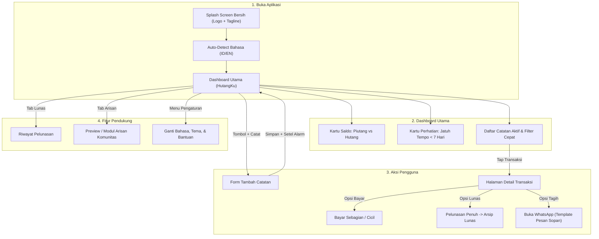
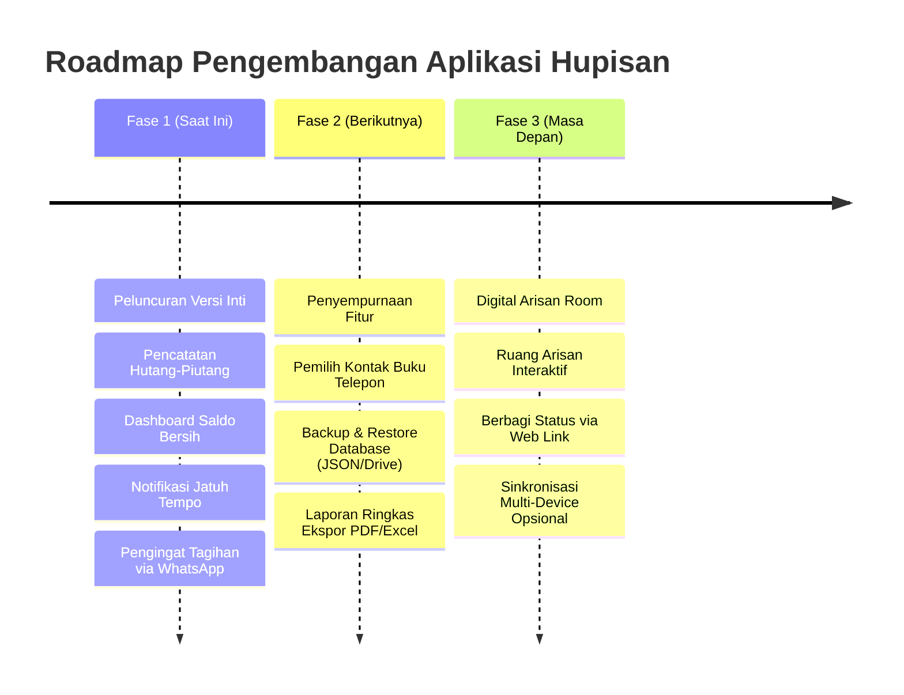

# DOKUMEN PRESENTASI PRODUK & STRUKTUR ALUR APLIKASI
## Hupisan (Financial Records) — Asisten Catatan Hutang, Piutang & Kas Komunitas

---

## 1. Ringkasan Eksekutif (Executive Summary)

### 1.1. Latar Belakang Masalah (The Problem)
Di kehidupan sehari-hari (personal, keluarga, maupun pelaku usaha kecil/warung), urusan pinjam-meminjam uang sering menimbulkan masalah:
1. **Sering Lupa:** Tidak dicatat rapi, lupa siapa yang berhutang atau kepada siapa kita berhutang.
2. **Sungkan / Canggung Menagih:** Banyak orang merasa tidak enak menagih uang ke teman/keluarga karena takut merusak hubungan.
3. **Buku Catatan Kertas Rentan:** Catatan fisik di kertas mudah hilang, terselip, kotor, atau rusak.
4. **Jatuh Tempo Terlewat:** Tidak ada sistem pengingat otomatis kapan pembayaran harus diselesaikan.

### 1.2. Solusi yang Diberikan Hupisan (The Solution)
**Hupisan** (*Hutang Piutang Arisan*) hadir sebagai solusi mobile yang **sederhana, cepat, dan tidak bertele-tele**:
- **Pencatatan Kilat (< 10 detik):** Catat hutang atau piutang dalam hitungan detik.
- **Transparansi Kas 1-Pandangan:** Tahu persis total piutang kita di orang lain vs total hutang yang harus kita bayar.
- **Pengingat Jatuh Tempo Cerdas:** Notifikasi alarm tepat waktu saat tenggat waktu mendekat.
- **Tagih Tanpa Canggung (WhatsApp 1-Klik):** Siapkan draf pesan tagihan yang ramah dan sopan langsung ke WhatsApp.
- **Privasi 100% Aman (Offline-First):** Seluruh data tersimpan aman di database lokal ponsel pengguna tanpa bocor ke internet.

---

## 2. Struktur Alur Pengguna (End-to-End User Flow)

Berikut adalah visualisasi alur perjalanan pengguna di dalam aplikasi:

---

## 3. Rincian Fitur Utama & Keunggulan bagi Pelanggan

### 3.1. Onboarding Bersih Tanpa Hambatan (*Zero-Friction Launch*)
- **Tanpa Registrasi Rumit:** Pengguna tidak perlu mendaftar akun email atau kata sandi; buka aplikasi langsung bisa dipakai.
- **Tanpa Popup Mengganggu:** Bahasa otomatis mendeteksi setelan perangkat (Bahasa Indonesia / Inggris). Izin notifikasi hanya diminta saat pengguna benar-benar menyalakan alarm.
- **Cepat:** Waktu muat dari klik ikon hingga masuk beranda hanya membutuhkan **kurang dari 1 detik**.

### 3.2. Dashboard Finansial yang Sangat Informatif (*Glanceable Dashboard*)
Layar beranda dirancang dengan tata letak visual modern:
1. **Kartu Saldo Finansial (Hero Card):**
   - 🟢 **Piutang Saya (Aset):** Total uang kita yang sedang dipinjam orang lain.
   - 🔴 **Hutang Saya (Kewajiban):** Total uang yang wajib kita bayarkan.
   - **Selisih Bersih:** Menunjukkan apakah posisi keuangan kita saat ini surplus atau defisit.
2. **Bagian *Perlu Perhatian Segera*:**
   - Sistem secara otomatis menyaring transaksi yang jatuh temponya kurang dari 7 hari ke depan, sehingga pengguna tidak perlu menelusuri daftar panjang satu per satu.
3. **Filter Cepat (*Segmented Chips*):**
   - Beralih dengan 1 ketukan: *Semua*, *Piutang Saja*, *Hutang Saja*, atau *Sudah Lunas*.

### 3.3. Pencatatan Transaksi Fleksibel (*Fast Input Form*)
- Pilihan kategori instan: **Hutang (Saya Pinjam)** atau **Piutang (Teman Pinjam)**.
- Input data yang esensial: Nama Orang, Nominal Uang, Catatan Keterangan, Tanggal Jatuh Tempo, dan Jam Alarm Pengingat.
- Validasi cerdas: Mencegah kesalahan ketik (nominal kosong, angka negatif, atau format salah).

### 3.4. Pelunasan & Cicilan Bertahap (*Installment Tracking*)
- Fleksibilitas pembayaran nyata:
  - **Cicil (Bayar Sebagian):** Sisa pokok berkurang otomatis, total yang sudah dibayar bertambah, dan tercatat riwayat tanggal pembayaran.
  - **Tambah Pinjaman:** Jika ada pinjaman susulan, nominal sisa hutang bertambah otomatis.
  - **Lunas Penuh:** Saat sisa menjadi Rp 0, status otomatis berpindah ke arsip *Lunas* dengan badge hijau rapi.

### 3.5. Fitur Pengingat WhatsApp Tanpa Canggung (*Polite Debt Reminder*)
- Salah satu nilai jual terkuat Hupisan:
  - Tombol **"Kirim Pengingat via WhatsApp"** di halaman detail.
  - Sekali klik, langsung membuka obrolan WhatsApp dengan teks sopan yang siap dikirim:
    > *"Halo [Nama], sekadar mengingatkan catatan [Hutang/Piutang] sebesar Rp [Nominal] dengan jatuh tempo pada tanggal [Tanggal]. Catatan ini dibuat melalui aplikasi Hupisan. Terima kasih banyak ya 🙏"*

### 3.6. Manajemen Arisan Komunitas (*Komunitas & Keluarga*)
- Pengelolaan arisan keluarga, kantor, atau RT/RW:
  - Pembuatan kelompok arisan dan anggaran setoran bulanan.
  - Penguncian status setoran (sudah bayar / belum).
  - **Undian Acak Digital (Kocok Arisan):** Animasi undian acak yang transparan dan adil, mencatat tanggal pemenang dan mencegah pemenang lama terpilih ganda di putaran yang sama.

---

## 4. Keunggulan Arsitektur & Keamanan (*Tech & Security Highlights*)

| Parameter | Spesifikasi Teknis Hupisan | Manfaat bagi Pengguna |
|---|---|---|
| **Arsitektur Kode** | MVVM (Model-View-ViewModel) + Koin DI | Aplikasi stabil, bebas lag, dan mudah dikembangkan |
| **Penyimpanan Data** | Room Database (SQLite Lokal) | 100% Offline-First; tetap jalan tanpa kuota internet |
| **Keamanan Privasi** | Zero External Leakage | Data hutang-piutang hanya ada di HP Anda, tidak dijual/disimpan di server luar |
| **Efisiensi Memori** | Single-task Backstack & No Memory Leaks | HP tidak panas dan hemat baterai |
| **Sistem Pengingat** | Android Exact AlarmManager | Alarm akurat dan tidak meluap walau jatuh tempo berbulan-bulan |

---

## 5. Roadmap Pengembangan Produk (Product Roadmap)

---

## 6. Kesimpulan Presentasi

**Hupisan** bukan sekadar aplikasi kalkulator atau catatan biasa. Hupisan adalah **solusi ketenangan pikiran (*peace of mind*)** bagi siapa saja yang ingin hubungan pertemanan dan keluarganya tetap hangat tanpa terusik urusan lupa hutang-piutang. 

Aplikasi ini siap digunakan, berpenampilan profesional, sangat ramah pengguna, dan siap dipresentasikan kepada pengguna maupun calon mitra bisnis.
