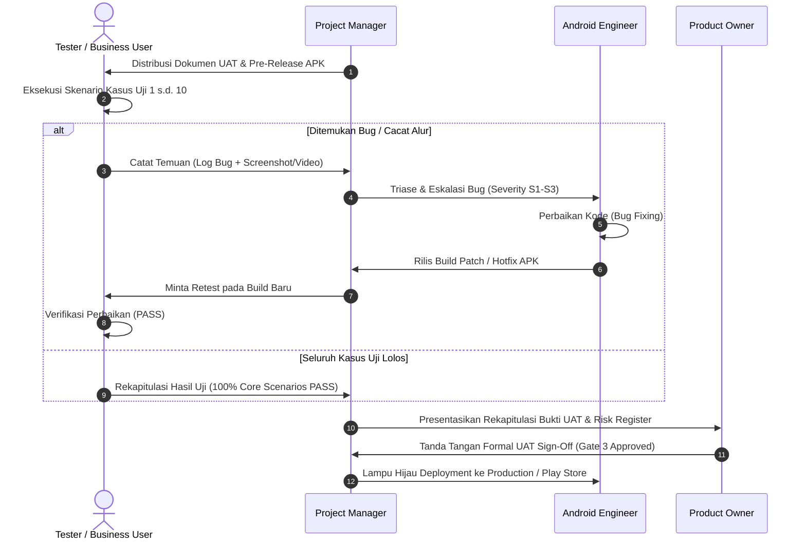

# PANDUAN DAN ALUR FLOW USER ACCEPTANCE TESTING (UAT)
## Financial Records (H.H.H.H) — Android Mobile App

**Versi Dokumen:** 1.0  
**Standar SOP:** Mengacu pada [Project Management Playbook Startup v1.0](file:///C:/Users/andre/.gemini/config/skills/project-manager/SKILL.md) (Gate 3: Release Approval)  
**Target Aplikasi:** Financial Records (my.notes.HHHH)  
**Lingkungan Uji:** Staging / Pre-Release APK (Device Fisik Android 8.0 s.d. Android 14)  
**Penanggung Jawab:** Project Manager, QA Engineer, Product Owner, & Stakeholder UAT  

---

## 1. Definisi & Tujuan UAT

User Acceptance Testing (UAT) adalah tahap pengujian formal terakhir sebelum aplikasi dirilis ke Google Play Store / pengguna umum. UAT bertujuan untuk:
1. Memvalidasi bahwa alur bisnis aplikasi (Pencatatan Hutang, Piutang, Cicilan, Pelunasan, dan Arisan Komunitas) telah berfungsi sesuai kebutuhan nyata pengguna.
2. Memastikan tidak ada cacat fungsional fatal (*zero critical defect*), celah logika hitungan uang, atau kendala navigasi buntu (*dead-ends*).
3. Memberikan kepastian berbasis bukti (*evidence-based readiness*) kepada Business Owner / Product Sponsor untuk menandatangani persetujuan rilis (**Gate 3 — Release Approval**).

---

## 2. Kriteria Gerbang UAT (Entry & Exit Criteria)

```mermaid
flowchart LR
    subgraph Entry["1. Entry Criteria (Syarat Masuk UAT)"]
        E1["Unit & Integration Test Lolos"]
        E2["Build APK Staging Siap"]
        E3["Zero Bug S1 / S2 di Internal QA"]
    end
    subgraph Execution["2. UAT Execution"]
        X1["Testing Skenario End-to-End"]
        X2["Triase Temuan & Bug Fix"]
        X3["Verifikasi Ulang (Retest)"]
    end
    subgraph Exit["3. Exit Criteria (Syarat Lolos Gate 3)"]
        C1["100% Test Case Utama PASS"]
        C2["Residual Risk Disetujui Tertulis"]
        C3["Formal Sign-off dari Product Owner"]
    end
    Entry --> Execution --> Exit
```

### 2.1. Syarat Masuk UAT (Entry Criteria)
- [ ] Fitur yang diuji telah selesai dikembangkan (memenuhi *Definition of Done* developer).
- [ ] Build APK staging/debug terverifikasi stabil tanpa crash saat startup.
- [ ] Dokumen skenario UAT telah disetujui bersama oleh PM, QA, dan Product Owner.
- [ ] Akun penguji dan device uji Android (versi OS lama dan baru) telah disiapkan.

### 2.2. Syarat Keluar UAT (Exit Criteria — Gate 3 Release Approval)
- [ ] **100% Kasus Uji Kritis (P1/P2) berstatus PASS.**
- [ ] **Zero Bug Critical (S1):** Tidak ada crash, data hilang, kalkulasi nominal salah, atau memori leak parah.
- [ ] Bug minor (S3/S4) yang belum diselesaikan telah dicatat dalam *Risk Register* dengan persetujuan formal dari Product Owner.
- [ ] Formulir *UAT Sign-off Certificate* telah ditandatangani oleh pemangku kepentingan berwenang.

---

## 3. Matriks Peran & Tanggung Jawab (RACI UAT)

| Peran | Tanggung Jawab Utama dalam UAT | RACI |
|---|---|:---:|
| **Project Manager (PM)** | Memfasilitasi jadwal UAT, memantau blocker, memimpin triase bug, dan mengawal checklist Gate 3 | **A / R** |
| **Product Owner / Business Sponsor** | Menjalankan validasi dari kacamata bisnis dan menandatangani persetujuan rilis akhir | **A** |
| **QA Engineer / Tester** | Menyiapkan data uji, memandu eksekusi skenario, dan mendokumentasikan log temuan | **R** |
| **Android Developer** | Memperbaiki bug yang ditemukan selama UAT dan menyediakan hotfix APK | **R** |

---

## 4. Diagram Alur Pelaksanaan UAT (Step-by-Step Flow)

---

## 5. Klasifikasi Tingkat Keparahan Bug (Bug Severity & Priority)

| Severity | Dampak Teknis / Fungsional | Target SLA Penanganan |
|---|---|---|
| **S1 - Critical** | Aplikasi crash/force close, data transaksi korup/hilang, perhitungan nominal cicilan salah, notifikasi gagal total. | **Harus difix < 4 jam.** Memblokir rilis. |
| **S2 - Major** | Fitur inti tidak bisa digunakan (e.g., tombol Arisan buntu), navigasi loop backstack tak terhingga, validasi gagal. | **Harus difix < 24 jam.** Memblokir rilis. |
| **S3 - Minor** | Masalah tampilan UI (teks terpotong, kontras tema gelap kurang terbaca, typo string, icon tidak presisi). | Diperbaiki sebelum rilis jika kapasitas ada. |
| **S4 - Trivial** | Saran peningkatan kosmetik atau animasi yang tidak mempengaruhi fungsionalitas. | Ditampung ke backlog fase berikutnya. |

---

## 6. Katalog Skenario & Kasus Uji UAT (Test Cases)

Berikut adalah 10 modul pengujian end-to-end yang wajib diuji secara runtut:

### Modul 1: Splash Screen, Perizinan, & Onboarding
| ID | Skenario Uji | Langkah Pengujian | Hasil yang Diharapkan | Status |
|:---:|---|---|---|:---:|
| **UAT-01-01** | Splash Screen & Bahasa Awal | Buka aplikasi pertama kali setelah instalasi bersih. | Splash screen muncul dengan lancar; jika bahasa belum disetel, muncul dialog pemilihan bahasa tanpa crash. | [ ] PASS [ ] FAIL |
| **UAT-01-02** | Verifikasi Izin Perangkat | Periksa permintaan izin saat aplikasi dibuka. | Aplikasi tidak meminta izin yang tidak relevan (seperti izin Kalender yang tidak terpakai). Izin notifikasi (Android 13+) diminta secara wajar. | [ ] PASS [ ] FAIL |
| **UAT-01-03** | Onboarding Slider | Geser layar intro, tekan *Selanjutnya*, *Sebelumnya*, dan *Lewati*. | Slider bergerak mulus; indikator worm sinkron; menekan *Selesai* atau *Lewati* membawa pengguna ke Dashboard utama tanpa loop. | [ ] PASS [ ] FAIL |

---

### Modul 2: Dashboard & Navigasi Utama (`MainActivity`)
| ID | Skenario Uji | Langkah Pengujian | Hasil yang Diharapkan | Status |
|:---:|---|---|---|:---:|
| **UAT-02-01** | Tampilan Banner Edukasi | Amati `ViewPager` auto-slider dan Page Indicator di bagian atas. | Animasi Lottie berjalan mulus; auto-slide berganti setiap 3 detik tanpa lag; warna latar transisi rapi. | [ ] PASS [ ] FAIL |
| **UAT-02-02** | Menu Utama 8 Kartu | Tap kartu satu per satu: Hutang, Piutang, Statistik, Arisan, Lunas, Grosir, Bantuan. | Tidak ada tombol buntu yang hanya menampilkan pesan statis tanpa alasan. Menu aktif membuka layar yang sesuai. | [ ] PASS [ ] FAIL |
| **UAT-02-03** | Log Aktivitas Terkini | Tambah transaksi baru, lalu kembali ke Dashboard. | Transaksi terbaru muncul di daftar horizontal Log Aktivitas; jika kosong, placeholder *"Belum ada aktivitas"* tampil elegan. | [ ] PASS [ ] FAIL |

---

### Modul 3: Manajemen Catatan Hutang (`HutangActivity` & `DetailHutangActivity`)
| ID | Skenario Uji | Langkah Pengujian | Hasil yang Diharapkan | Status |
|:---:|---|---|---|:---:|
| **UAT-03-01** | Tambah Hutang Baru | Buka menu Hutang -> Tap FAB Tambah (+) -> Isi Nama ("Budi"), Jumlah ("500.000"), Tanggal Jatuh Tempo, Aktifkan Notifikasi -> Simpan. | Data berhasil tersimpan; muncul feedback sukses; daftar hutang terupdate otomatis menampilkan saldo Budi Rp 500.000. | [ ] PASS [ ] FAIL |
| **UAT-03-02** | Validasi Input Negatif & Kosong | Kosongkan nama atau masukkan 1 huruf; isi nominal 0 atau negatif; isi keterangan > 210 karakter. | Sistem menampilkan pesan error validasi yang informatif; tombol simpan mencegah input data yang tidak valid. | [ ] PASS [ ] FAIL |
| **UAT-03-03** | Pembayaran Cicilan (Kurangi Hutang) | Buka Detail Hutang Budi -> Tap FAB Aksi -> Pilih Cicil -> Masukkan nominal cicilan "200.000" -> Konfirmasi. | Sisa hutang berkurang tepat menjadi Rp 300.000; total terbayar menjadi Rp 200.000; item riwayat pembayaran baru tercatat di log detail. | [ ] PASS [ ] FAIL |
| **UAT-03-04** | Validasi Cicilan Melebihi Hutang | Pada hutang Rp 300.000, coba masukkan cicilan Rp 400.000. | Sistem menolak transaksi dan memunculkan peringatan bahwa nominal cicilan tidak boleh melebihi sisa hutang (tanpa teks aneh *"false/true"*). | [ ] PASS [ ] FAIL |
| **UAT-03-05** | Penambahan Hutang Baru ke Orang yang Sama | Buka Detail Hutang -> Tap FAB Aksi -> Pilih Tambah -> Masukkan Rp 100.000. | Sisa hutang bertambah menjadi Rp 400.000; log riwayat mencatat penambahan hutang. | [ ] PASS [ ] FAIL |
| **UAT-03-06** | Pelunasan Penuh (Status Lunas) | Buka Detail Hutang -> Pilih Aksi Lunas -> Konfirmasi pelunasan. | Hutang berhasil dinyatakan lunas; feedback menampilkan nominal pelunasan yang benar; data berpindah dari daftar Hutang Aktif ke menu Lunas. | [ ] PASS [ ] FAIL |
| **UAT-03-07** | Hapus Data dengan Konfirmasi Nama | Geser (swipe) item hutang ke samping -> Muncul alert konfirmasi -> Ketik ulang nama peminjam -> Konfirmasi hapus. | Data terhapus aman dari database; jika nama yang diketik tidak cocok, tombol hapus terkunci/menolak eksekusi. | [ ] PASS [ ] FAIL |

---

### Modul 4: Manajemen Catatan Piutang (Uang yang Dipinjamkan ke Orang Lain)
| ID | Skenario Uji | Langkah Pengujian | Hasil yang Diharapkan | Status |
|:---:|---|---|---|:---:|
| **UAT-04-01** | Pencatatan Piutang Baru | Buka menu Piutang -> Tap FAB (+) -> Catat piutang atas nama "Siti" sebesar "1.000.000". | Label halaman konsisten bertuliskan "Piutang"; data tersimpan dan terpisah secara tegas dari data Hutang. | [ ] PASS [ ] FAIL |
| **UAT-04-02** | Penerimaan Cicilan Piutang | Buka Detail Piutang Siti -> Catat penerimaan cicilan "500.000". | Saldo piutang berkurang menjadi Rp 500.000; riwayat penerimaan uang tercatat akurat. | [ ] PASS [ ] FAIL |

---

### Modul 5: Sistem Pengingat & Notifikasi Jatuh Tempo
| ID | Skenario Uji | Langkah Pengujian | Hasil yang Diharapkan | Status |
|:---:|---|---|---|:---:|
| **UAT-05-01** | Penjadwalan Alarm Jatuh Tempo | Tambah catatan dengan mengaktifkan tombol notifikasi, atur jatuh tempo pada jam terdekat (e.g. 5 menit ke depan). | Saat waktu tiba, notifikasi muncul di status bar Android dengan judul *"Jatuh Tempo"* dan teks pengingat yang jelas. | [ ] PASS [ ] FAIL |
| **UAT-05-02** | Multi-Notification Independence | Tambahkan 3 transaksi berbeda dengan pengingat waktu masing-masing. | Ketiga notifikasi berbunyi sesuai jadwal tanpa saling menimpa (*no ID collision*). | [ ] PASS [ ] FAIL |
| **UAT-05-03** | Uji Ketahanan Pasca-Reboot | Jadwalkan notifikasi -> Matikan HP -> Nyalakan kembali HP (Reboot) -> Tunggu hingga waktu alarm. | Sistem berhasil menjadwalkan ulang alarm (*boot completed resync*); notifikasi tetap berbunyi pasca-reboot. | [ ] PASS [ ] FAIL |

---

### Modul 6: Siklus Lengkap Modul Arisan (`FitureArisanActivity`)
| ID | Skenario Uji | Langkah Pengujian | Hasil yang Diharapkan | Status |
|:---:|---|---|---|:---:|
| **UAT-06-01** | Pembuatan Grup Arisan Baru | Buka menu Arisan -> Pilih *Buat Acara* -> Input Nama Grup ("Arisan Keluarga"), Iuran Per Anggota ("100.000"). | Grup baru terbentuk dengan status *"Belum Dimulai"*; total terkumpul awal Rp 0. | [ ] PASS [ ] FAIL |
| **UAT-06-02** | Tambah Anggota Grup Arisan | Buka grup yang baru dibuat -> Tap FAB Tambah Anggota -> Masukkan 5 nama peserta dengan status gender masing-masing. | Kelima peserta terdaftar dalam grid anggota; jumlah member dan potensi Prize Pool otomatis terhitung (5 × Rp 100.000 = Rp 500.000). | [ ] PASS [ ] FAIL |
| **UAT-06-03** | Pembayaran Iuran Anggota | Tandai 5 anggota telah membayar iuran periode ini. | Status anggota berubah menjadi siap undi; dana terkumpul terupdate menjadi Rp 500.000. | [ ] PASS [ ] FAIL |
| **UAT-06-04** | Mulai Acara Arisan | Tekan tombol *Mulai Acara Arisan*. | Status grup berubah menjadi *"Dimulai"*; grup berpindah ke tab *Acara yang Dimulai*; tombol kocok pemenang aktif. | [ ] PASS [ ] FAIL |
| **UAT-06-05** | Pengundian Pemenang (Kocok Arisan) | Tekan tombol *Kocok Arisan* (FAB Kocok). | Animasi pengacakan nama berjalan lancar; terpilih 1 nama pemenang secara acak; status anggota tersebut ditandai *"Menang"*. | [ ] PASS [ ] FAIL |
| **UAT-06-06** | Pengundian Periode Berikutnya | Lakukan pengocokan putaran kedua pada periode berikutnya. | Anggota yang sudah menang di putaran pertama tidak boleh terpilih kembali hingga seluruh anggota lainnya menang. | [ ] PASS [ ] FAIL |

---

### Modul 7: Riwayat Pelunasan (`LunasActivity`)
| ID | Skenario Uji | Langkah Pengujian | Hasil yang Diharapkan | Status |
|:---:|---|---|---|:---:|
| **UAT-07-01** | Tampilan Daftar Arsip Lunas | Buka menu Lunas dari Dashboard. | Seluruh transaksi yang telah dilunasi tampil lengkap dengan rincian tanggal pelunasan dan total nominal. | [ ] PASS [ ] FAIL |
| **UAT-07-02** | Filter Tab Lunas | Buka panel bottom sheet filter -> Pilih filter "Hutang Saja" lalu "Piutang Saja". | Daftar transaksi terfilter secara tepat sesuai kategori yang dipilih. | [ ] PASS [ ] FAIL |

---

### Modul 8: Statistik & Analitik Keuangan (`StatisticActivity`)
| ID | Skenario Uji | Langkah Pengujian | Hasil yang Diharapkan | Status |
|:---:|---|---|---|:---:|
| **UAT-08-01** | Rekap Tabulasi Hutang vs Piutang | Buka menu Statistik -> Beralih antara tab Hutang dan tab Piutang. | Angka nominal total terhitung akurat sesuai database; pergantian tab responsif dan ikon aktif berubah jelas. | [ ] PASS [ ] FAIL |
| **UAT-08-02** | Integritas Grafik Visual | Periksa tampilan diagram/chart peminjaman. | Grafik tidak crash saat data 0; warna kontras jelas; representasi data logis dan mudah dipahami. | [ ] PASS [ ] FAIL |

---

### Modul 9: Pengaturan, Bahasa, & Dukungan Pengguna (`SettingsActivity`)
| ID | Skenario Uji | Langkah Pengujian | Hasil yang Diharapkan | Status |
|:---:|---|---|---|:---:|
| **UAT-09-01** | Penggantian Bahasa Aplikasi | Buka Pengaturan -> Pilih Bahasa -> Ganti dari Bahasa Indonesia ke English. | Seluruh label teks antarmuka berganti ke Bahasa Inggris seketika tanpa perlu restart manual yang membingungkan. | [ ] PASS [ ] FAIL |
| **UAT-09-02** | Penggantian Tema (Dark Mode) | Buka Pengaturan -> Aktifkan Tema Gelap (Dark Mode). | Tampilan beralih ke warna gelap; seluruh teks tetap terbaca dengan kontras tinggi; tidak ada teks hitam di atas background hitam. | [ ] PASS [ ] FAIL |
| **UAT-09-03** | Halaman Bantuan & Cara Pakai | Buka menu Bantuan / Cara Menggunakan dari Dashboard atau Pengaturan. | Panduan penggunaan muncul lengkap dengan alur langkah yang mudah dipahami oleh pengguna awam. | [ ] PASS [ ] FAIL |

---

### Modul 10: Ketahanan Teknis, Integritas Data, & Edge Cases
| ID | Skenario Uji | Langkah Pengujian | Hasil yang Diharapkan | Status |
|:---:|---|---|---|:---:|
| **UAT-10-01** | Rotasi Layar (Orientation Change) | Buka form input hutang yang sudah terisi separuh -> Putar layar menjadi Landscape -> Kembalikan ke Portrait. | Data input di EditText tidak hilang; layout menyesuaikan tanpa terpotong (*state restoration OK*). | [ ] PASS [ ] FAIL |
| **UAT-10-02** | Ketahanan Saat Aplikasi Ditutup Paksa | Tambah 3 catatan -> Tutup paksa aplikasi dari Recent Apps -> Buka kembali aplikasi. | Seluruh data Room DB tetap utuh tanpa korupsi data. | [ ] PASS [ ] FAIL |
| **UAT-10-03** | Uji Nominal Ekstrem (Boundary Value) | Masukkan nominal transaksi besar (e.g. Rp 1.500.000.000). | Format desimal ribuan rapi; tidak terjadi integer overflow; perhitungan saldo tetap presisi. | [ ] PASS [ ] FAIL |
| **UAT-10-04** | Navigasi Back Button Cepat | Tekan tombol hardware back berkali-kali dari layar terdalam. | Aplikasi kembali satu per satu secara runut dan keluar saat di Home, tanpa membuka ulang layar-layar lama yang sudah ditutup (*no activity stacking*). | [ ] PASS [ ] FAIL |

---

## 7. Format Log Temuan Bug UAT (Defect Log Template)

Gunakan tabel berikut untuk mencatat kendala yang ditemukan saat sesi UAT berlangsung:

| No | ID Kasus | Deskripsi Masalah / Bug | Langkah Reproduksi | Hasil Aktual | Hasil yang Diharapkan | Severity | PIC Fix | Status |
|:---:|:---:|---|---|---|---|:---:|:---:|:---:|
| 1 | UAT-03-04 | Snackbar menampilkan teks boolean aneh | Input cicilan melebihi sisa hutang | Muncul: *"Nominal tidak boleh melebihi false"* | Muncul: *"Nominal tidak boleh melebihi sisa hutang"* | S2 | @AndroidDev | Open |
| 2 | UAT-02-02 | Tombol Arisan di Dashboard terkunci | Tap menu Arisan pada Home | Muncul Snackbar *"fitur sedang dikembangkan"* | Membuka layar `FitureArisanActivity` | S2 | @AndroidDev | Open |
| 3 | UAT-05-01 | Pengingat kedua menimpa pengingat pertama | Buat 2 hutang dengan waktu pengingat berbeda | Notifikasi pertama tidak pernah muncul | Kedua notifikasi berbunyi sesuai jadwal | S1 | @AndroidDev | Open |

---

## 8. Sertifikat Persetujuan Rilis UAT (Gate 3 Sign-Off Certificate)

*(Bagian ini wajib diisi dan ditandatangani bersama setelah seluruh pengujian selesai)*

### Rekapitulasi Hasil Pengujian:
- **Total Kasus Uji:** 28 Skenario
- **Total Kasus Lolos (PASS):** [ ___ ] Kasus ([ ___ ]%)
- **Total Kasus Gagal (FAIL):** [ ___ ] Kasus
- **Status Bug Kritis (S1 & S2):** [ 0 ] Bug Terbuka *(Wajib 0 untuk rilis)*
- **Risiko Residual yang Diterima:** [Sebutkan jika ada bug minor S3/S4 yang ditunda ke rilis berikutnya]

### Pernyataan Persetujuan Rilis (Sign-Off):
Dengan ini dinyatakan bahwa aplikasi **Financial Records (H.H.H.H) Versi [1.0]** telah melalui tahapan User Acceptance Testing (UAT) secara memadai. Kualitas hasil pekerjaan telah diverifikasi berbasis bukti, dan aplikasi dinyatakan:

> **[  ] DISETUJUI UNTUK RILIS KE PRODUCTION (RELEASE APPROVED)**  
> **[  ] DITUNDA / MEMBUTUHKAN PERBAIKAN ULANG (RE-TEST REQUIRED)**  

| Pihak Penandatangan | Nama Lengkap | Jabatan / Role | Tanda Tangan / Persetujuan | Tanggal |
|---|---|---|---|:---:|
| **Lead QA Tester** | ____________________ | QA Lead / Tester | [ Disetujui ] | DD/MM/YYYY |
| **Android Tech Lead** | ____________________ | Android Engineering Lead | [ Disetujui ] | DD/MM/YYYY |
| **Project Manager** | ____________________ | Project Manager (Gate 3 Controller) | [ Disetujui ] | DD/MM/YYYY |
| **Product Owner / Sponsor** | ____________________ | Product Owner / Business Sponsor | **[ FINAL SIGN-OFF ]** | DD/MM/YYYY |
