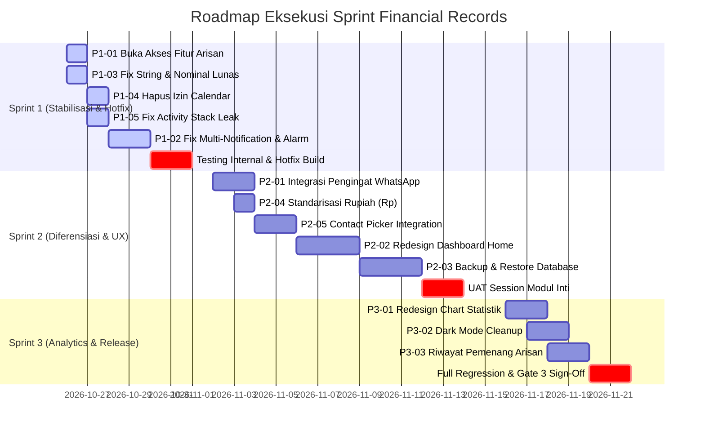

# DETAIL MATRIKS PRIORITAS EKSEKUSI (FEEDBACK & ACTION PLAN)
## Financial Records (H.H.H.H) — Android Mobile App

**Versi Dokumen:** 1.0  
**Tanggal Penyusunan:** 25 Oktober 2026  
**Disusun Oleh:** Project Manager (Mengacu pada [PM Playbook Startup v1.0](file:///C:/Users/andre/.gemini/config/skills/project-manager/SKILL.md))  
**Target Rilis:** Sprint 1 s.d. Sprint 3 (Stabilisasi -> Diferensiasi -> Skalabilitas)  
**Status Dokumen:** Active / Siap Eksekusi  

---

## 1. Kerangka Kerja & Formula Prioritisasi

Untuk memastikan keputusan alokasi kapasitas tim bersifat objektif dan tidak didasarkan pada asumsi subjektif (Rule 4 PM Playbook), setiap inisiatif perbaikan dinilai menggunakan **Formula Skoring Matriks Startup**:

$$\text{Priority Score} = \frac{\text{Impact} \times \text{Urgency} \times \text{Risk}}{\text{Effort}}$$

### Skala Penilaian (1 sampai 5):
- **Impact (1-5):** Seberapa besar dampaknya terhadap retensi pengguna, nilai bisnis, dan stabilitas fungsional.
- **Urgency (1-5):** Seberapa mendesak perbaikan ini diselesaikan (keterkaitan dengan blocker rilis Play Store).
- **Risk (1-5):** Tingkat risiko terhadap proyek jika perbaikan ini ditunda (risiko crash, reputasi, penolakan toko aplikasi, atau data hilang).
- **Effort (1-5):** Estimasi kompleksitas dan waktu pengerjaan (skor 1 = < 4 jam; skor 5 = > 4 hari kerja).

### Klasifikasi Tingkat Prioritas (Tiering):
1. **P1 — Critical (Skor $\ge$ 30 atau Blocker Rilis):** Wajib dieksekusi segera di **Sprint 1 (Hotfix & Stabilization)**. Memblokir rilis jika tidak selesai.
2. **P2 — High (Skor 12 – 29.9):** Inisiatif strategis yang dikerjakan pada **Sprint 2 (Core Experience & Feature Differentiation)**.
3. **P3 — Medium (Skor 6 – 11.9):** Peningkatan kualitas antarmuka dan analitik pada **Sprint 3 (Polish & Analytics)**.
4. **P4 — Low / Backlog (Skor < 6):** Fitur pelengkap jangka panjang yang ditampung ke roadmap fase berikutnya.

---

## 2. Tabel Master Matriks Prioritas Eksekusi

| Rank | ID | Area / Kategori | Inisiatif Perbaikan & Solusi | File Target Utama | I | U | R | E | Skor | Tier | Est. Waktu |
|:---:|:---:|:---|:---|:---|:---:|:---:|:---:|:---:|:---:|:---:|:---:|
| **1** | **P1-01** | Feature Flow | Buka akses modul Arisan di Home (ganti Snackbar dengan Intent ke `FitureArisanActivity`) | [`MainActivity.kt#L102`](file:///C:/Users/andre/StudioProjects/H.H.H.H/app/src/main/java/my/notes/HHHH/view/main/MainActivity.kt#L102) | 5 | 5 | 4 | 1 | **100.0** | **P1** | 2 Jam |
| **2** | **P1-03** | Code / UX | Perbaiki string concatenation aneh (*"melebihi false"*) & nominal pelunasan Rp 0 | [`DetailHutangActivity.kt#L296`](file:///C:/Users/andre/StudioProjects/H.H.H.H/app/src/main/java/my/notes/HHHH/view/hutang/DetailHutangActivity.kt#L296) | 4 | 5 | 4 | 1 | **80.0** | **P1** | 2 Jam |
| **3** | **P1-04** | Compliance | Hapus permintaan izin `WRITE_CALENDAR` yang tidak terpakai di Splash & Manifest | [`SplashScreenActivity.kt#L53`](file:///C:/Users/andre/StudioProjects/H.H.H.H/app/src/main/java/my/notes/HHHH/view/spalshscreen/SplashScreenActivity.kt#L53) | 4 | 4 | 5 | 1 | **80.0** | **P1** | 2 Jam |
| **4** | **P1-05** | Architecture | Hapus activity stacking memory leak (ganti `startActivity` dengan `finish()`) | [`AddHutangActivity.kt#L89`](file:///C:/Users/andre/StudioProjects/H.H.H.H/app/src/main/java/my/notes/HHHH/view/hutang/AddHutangActivity.kt#L89) | 4 | 4 | 4 | 1 | **64.0** | **P1** | 3 Jam |
| **5** | **P1-02** | Code / Logic | Perbaiki collision ID AlarmManager (=1), integer overflow, & resync saat reboot | [`AddHutangActivity.kt#L159`](file:///C:/Users/andre/StudioProjects/H.H.H.H/app/src/main/java/my/notes/HHHH/view/hutang/AddHutangActivity.kt#L159)<br>[`NotificationService.kt`](file:///C:/Users/andre/StudioProjects/H.H.H.H/app/src/main/java/my/notes/HHHH/notification/service/NotificationService.kt) | 5 | 5 | 5 | 2 | **62.5** | **P1** | 1 Hari |
| **6** | **P2-01** | Growth / UX | Tambahkan tombol kirim pengingat tagihan via WhatsApp dengan template sopan | [`DetailHutangActivity.kt`](file:///C:/Users/andre/StudioProjects/H.H.H.H/app/src/main/java/my/notes/HHHH/view/hutang/DetailHutangActivity.kt)<br>[`content_detail_hutang.xml`](file:///C:/Users/andre/StudioProjects/H.H.H.H/app/src/main/res/layout/content_detail_hutang.xml) | 5 | 4 | 3 | 2 | **30.0** | **P2** | 1 Hari |
| **7** | **P2-03** | Data Safety | Tambahkan fitur Backup & Restore database lokal (Export/Import file JSON terenkripsi) | [`SettingsActivity.kt`](file:///C:/Users/andre/StudioProjects/H.H.H.H/app/src/main/java/my/notes/HHHH/view/pengaturan/SettingsActivity.kt)<br>Database Helper | 5 | 4 | 4 | 3 | **26.6** | **P2** | 2 Hari |
| **8** | **P2-02** | UI / XML | Redesign layout Home: rampingkan banner Lottie, tonjolkan card total saldo | [`activity_main.xml`](file:///C:/Users/andre/StudioProjects/H.H.H.H/app/src/main/res/layout/activity_main.xml)<br>[`MainActivity.kt`](file:///C:/Users/andre/StudioProjects/H.H.H.H/app/src/main/java/my/notes/HHHH/view/main/MainActivity.kt) | 5 | 4 | 3 | 3 | **20.0** | **P2** | 2 Hari |
| **9** | **P2-04** | Localization | Standarisasi format mata uang Rupiah (`Rp`) & pemformatan ribuan Indonesia | [`strings.xml`](file:///C:/Users/andre/StudioProjects/H.H.H.H/app/src/main/res/values/strings.xml)<br>Adapters & Details | 4 | 4 | 2 | 2 | **16.0** | **P2** | 1 Hari |
| **10** | **P2-05** | Usability | Integrasi pemilih kontak telepon (`Intent.ACTION_PICK`) saat input nama peminjam | [`AddHutangActivity.kt`](file:///C:/Users/andre/StudioProjects/H.H.H.H/app/src/main/java/my/notes/HHHH/view/hutang/AddHutangActivity.kt)<br>[`activity_add_hutang.xml`](file:///C:/Users/andre/StudioProjects/H.H.H.H/app/src/main/res/layout/activity_add_hutang.xml) | 4 | 3 | 2 | 2 | **12.0** | **P2** | 1 Hari |
| **11** | **P3-01** | Analytics | Perbaiki Pie Chart akumulatif waktu menjadi Summary Metric Card / Bar Chart | [`HutangFragment.kt`](file:///C:/Users/andre/StudioProjects/H.H.H.H/app/src/main/java/my/notes/HHHH/view/analistic/HutangFragment.kt)<br>[`fragment_hutang.xml`](file:///C:/Users/andre/StudioProjects/H.H.H.H/app/src/main/res/layout/fragment_hutang.xml) | 3 | 3 | 2 | 2 | **9.0** | **P3** | 1 Hari |
| **12** | **P3-02** | UI / Theme | Bersihkan warna hardcoded heksadesimal & sinkronisasi kontras Dark Mode | Layout XML & `themes.xml` | 3 | 3 | 2 | 2 | **9.0** | **P3** | 1 Hari |
| **13** | **P3-03** | Arisan Logic | Tambahkan pencatatan riwayat pemenang arisan per putaran / bulan | [`ArisanMemberActivity.kt`](file:///C:/Users/andre/StudioProjects/H.H.H.H/app/src/main/java/my/notes/HHHH/view/arisan/ArisanMemberActivity.kt) | 3 | 2 | 2 | 2 | **6.0** | **P3** | 1 Hari |
| **14** | **P4-01** | Feature | Multi-Currency Switcher (USD, EUR, SGD, MYR) di Pengaturan | [`SettingsActivity.kt`](file:///C:/Users/andre/StudioProjects/H.H.H.H/app/src/main/java/my/notes/HHHH/view/pengaturan/SettingsActivity.kt) | 2 | 1 | 1 | 3 | **0.6** | **P4** | 2 Hari |
| **15** | **P4-02** | Cloud Scale | Cloud Synchronization multi-device via Firebase / Supabase Auth | Cloud Backend Module | 4 | 1 | 3 | 5 | **2.4** | **P4** | 5 Hari |

---

## 3. Rincian Teknis & Panduan Eksekusi per Item Prioritas

### 🔴 Kelompok P1 — Critical (Sprint 1: Hotfix & Stabilisasi)

#### 1. [P1-01] Buka Kunci Akses Modul Arisan di Halaman Utama
- **Permasalahan Saat Ini:** Tombol Arisan di dashboard utama saat ini diblokir dengan Snackbar statis *"Fitur sedang dikembangkan"*, padahal modul [`FitureArisanActivity`](file:///C:/Users/andre/StudioProjects/H.H.H.H/app/src/main/java/my/notes/HHHH/view/arisan/FitureArisanActivity.kt) sudah dibangun lengkap dengan database dan ViewModel.
- **Rencana Tindakan:**
  Ubah event listener pada [`MainActivity.kt#L102-L104`](file:///C:/Users/andre/StudioProjects/H.H.H.H/app/src/main/java/my/notes/HHHH/view/main/MainActivity.kt#L102-L104):
  ```kotlin
  // SEBELUMNYA:
  binding.cardViewArisan.setOnClickListener {
      Snackbar.make(binding.constraint, getString(R.string.fitur_sedang_dikembangkan), Snackbar.LENGTH_SHORT).show()
  }

  // PERBAIKAN:
  binding.cardViewArisan.setOnClickListener {
      startActivity(Intent(this, FitureArisanActivity::class.java))
  }
  ```
- **Kriteria Penerimaan (DoD):** Menekan kartu Arisan di dashboard langsung mengarahkan pengguna ke layar pemilihan acara Arisan tanpa peringatan error.

---

#### 2. [P1-02] Perbaiki Bug Collision ID AlarmManager & Ketahanan Reboot
- **Permasalahan Saat Ini:**
  1. `NOTIFICATION_ID` di-hardcode ke angka `1` ([`AddHutangActivity.kt#L159`](file:///C:/Users/andre/StudioProjects/H.H.H.H/app/src/main/java/my/notes/HHHH/view/hutang/AddHutangActivity.kt#L159)), sehingga alarm untuk transaksi baru menimpa alarm transaksi sebelumnya.
  2. Casting `postDelay.toInt()` meluap (*integer overflow*) menjadi bilangan negatif jika jatuh tempo > 24 hari.
  3. `NotificationService` tidak menjadwalkan ulang alarm saat menerima broadcast `BOOT_COMPLETED`.
- **Rencana Tindakan:**
  1. Gunakan unique ID transaksi dari primary key database (`DataModel.id`) sebagai ID unik alarm `PendingIntent`.
  2. Gunakan trigger berbasis waktu absolut epoch: `AlarmManager.RTC_WAKEUP` dengan parameter `targetTimestampMillis` (tipe `Long`, bukan `Int`).
  3. Pada receiver `BOOT_COMPLETED` di [`NotificationService.kt`](file:///C:/Users/andre/StudioProjects/H.H.H.H/app/src/main/java/my/notes/HHHH/notification/service/NotificationService.kt), lakukan *query* ke Room DB untuk transaksi aktif yang memiliki notifikasi = true dan daftarkan ulang seluruh alarm ke `AlarmManager`.
- **Kriteria Penerimaan (DoD):** Pengguna dapat membuat 5 pengingat berbeda tanpa saling menimpa, dan seluruh pengingat tetap berbunyi tepat waktu meskipun ponsel telah dimatikan dan dinyalakan ulang.

---

#### 3. [P1-03] Perbaiki String Concatenation & Label Pelunasan Rusak
- **Permasalahan Saat Ini:**
  1. Di [`DetailHutangActivity.kt#L296 & L310`](file:///C:/Users/andre/StudioProjects/H.H.H.H/app/src/main/java/my/notes/HHHH/view/hutang/DetailHutangActivity.kt#L296), Snackbar memunculkan teks *"Nominal tidak boleh melebihi false/true"*.
  2. Di [`DetailHutangActivity.kt#L347`](file:///C:/Users/andre/StudioProjects/H.H.H.H/app/src/main/java/my/notes/HHHH/view/hutang/DetailHutangActivity.kt#L347), notifikasi lunas menampilkan nominal `$ 0` padahal hutang yang dilunasi memiliki nilai ratusan ribu.
- **Rencana Tindakan:**
  - Ambil label jenis pinjaman yang ramah pengguna (`getString(R.string.hutang)` atau `getString(R.string.piutang)`), bukan boolean mentah.
  - Tampilkan `alertJumlah` atau `activityJumlah` pada pesan sukses pelunasan:
    ```kotlin
    Snackbar.make(
        binding.clRootContent,
        "${getString(R.string.berhasil_dilunasi)} ${getString(R.string.dolar)} ${dateFormat.format(alertJumlah)}",
        Snackbar.LENGTH_SHORT
    ).show()
    ```
- **Kriteria Penerimaan (DoD):** Pesan kesalahan validasi dan feedback pelunasan berbunyi jelas, sopan, dan mencantumkan angka uang yang sebenarnya.

---

#### 4. [P1-04] Eliminasi Permintaan Izin Kalender yang Tidak Terpakai
- **Permasalahan Saat Ini:** [`SplashScreenActivity.kt#L53`](file:///C:/Users/andre/StudioProjects/H.H.H.H/app/src/main/java/my/notes/HHHH/view/spalshscreen/SplashScreenActivity.kt#L53) dan [`AndroidManifest.xml#L6`](file:///C:/Users/andre/StudioProjects/H.H.H.H/app/src/main/AndroidManifest.xml#L6) mewajibkan izin `WRITE_CALENDAR`, padahal fitur ini tidak digunakan sama sekali dalam kode. Ini berpotensi memicu penolakan rilis Play Store.
- **Rencana Tindakan:**
  - Hapus `<uses-permission android:name="android.permission.WRITE_CALENDAR" />` dari Manifest.
  - Hapus pemeriksaan izin kalender di `SplashScreenActivity`. Cukup periksa izin notifikasi (`POST_NOTIFICATIONS`) untuk Android 13+.
- **Kriteria Penerimaan (DoD):** Aplikasi langsung masuk ke halaman utama tanpa memunculkan dialog izin kalender yang mencurigakan bagi pengguna.

---

#### 5. [P1-05] Perbaiki Memory Leak Akibat Activity Stacking Loop
- **Permasalahan Saat Ini:** Pada [`AddHutangActivity.kt#L89`](file:///C:/Users/andre/StudioProjects/H.H.H.H/app/src/main/java/my/notes/HHHH/view/hutang/AddHutangActivity.kt#L89) dan baris 134, tombol simpan dan navigasi back memanggil `startActivity(Intent(this, HutangActivity::class.java))` baru.
- **Rencana Tindakan:**
  Ganti pemanggilan `startActivity` dengan `finish()` agar Activity form ditutup dengan benar dan Activity daftar sebelumnya otomatis tampil kembali dari backstack.
- **Kriteria Penerimaan (DoD):** Menekan tombol simpan atau tombol kembali langsung kembali ke layar sebelumnya tanpa membuka instance Activity baru.

---

### 🟠 Kelompok P2 — High (Sprint 2: Core Experience & Diferensiasi)

#### 6. [P2-01] Integrasi Tombol Kirim Pengingat Tagihan via WhatsApp
- **Alasan Bisnis:** Fitur paling dicari dalam pencatatan hutang adalah kemudahan menagih secara halus tanpa rasa canggung.
- **Rencana Tindakan:**
  Tambahkan tombol *"Kirim Pengingat WhatsApp"* di [`content_detail_hutang.xml`](file:///C:/Users/andre/StudioProjects/H.H.H.H/app/src/main/res/layout/content_detail_hutang.xml). Saat ditekan, sistem membuka WhatsApp dengan format pesan otomatis:
  > *"Halo [Nama], sekadar mengingatkan catatan [Hutang/Piutang] sebesar Rp [Nominal] dengan jatuh tempo pada tanggal [Tanggal]. Catatan ini dikirim melalui aplikasi Financial Records. Terima kasih 🙏"*
- **Kriteria Penerimaan (DoD):** Tombol membuka WhatsApp dengan teks tagihan yang siap dikirim langsung ke kontak tujuan.

---

#### 7. [P2-02] Redesign Layout Dashboard (`activity_main.xml`)
- **Alasan Bisnis:** Layanan finansial harus menampilkan status kas utama (*Health Dashboard*) di pandangan pertama pengguna (*above the fold*).
- **Rencana Tindakan:**
  - Perkecil banner auto-slider dari `@dimen/_170sdp` menjadi kartu ringkas `@dimen/_90sdp` atau jadikan banner yang bisa di-dismiss.
  - Tampilkan **Kartu Saldo Finansial** di bagian paling atas:
    - 🔴 **Total Hutang Saya:** `Rp xxx.xxx`
    - 🟢 **Total Piutang Saya:** `Rp xxx.xxx`
    - 🔵 **Arisan Berjalan:** `X Acara`
  - Susun ulang 4 menu utama dengan layout grid dinamis yang tidak memotong teks.
- **Kriteria Penerimaan (DoD):** Pengguna dapat langsung mengetahui total hutang dan piutang mereka seketika setelah aplikasi dibuka.

---

#### 8. [P2-03] Fitur Backup & Restore Database Lokal (Data Safety)
- **Alasan Bisnis:** Pengguna tidak mau mencatat hutang jika datanya berisiko hilang saat ganti perangkat.
- **Rencana Tindakan:**
  Buat fitur ekspor/impor file di [`SettingsActivity.kt`](file:///C:/Users/andre/StudioProjects/H.H.H.H/app/src/main/java/my/notes/HHHH/view/pengaturan/SettingsActivity.kt):
  1. **Backup Data:** Mengemas seluruh entitas Room DB menjadi berkas `.json` terenkripsi dan disimpan di folder Unduhan / Google Drive pengguna via Storage Access Framework (SAF).
  2. **Restore Data:** Membaca kembali berkas backup dan melakukan upsert data ke Room database.
- **Kriteria Penerimaan (DoD):** Pengguna dapat mengekspor data catatan dan memulihkannya kembali di perangkat baru dengan 100% data presisi.

---

#### 9. [P2-04] Standarisasi Mata Uang Rupiah (`Rp`) & Format Angka Indonesia
- **Alasan Bisnis:** Aplikasi berorientasi lokal tetapi simbol mata uang di-hardcode dolar (`$`).
- **Rencana Tindakan:**
  - Ganti string resource `@string/dolar` menjadi `"Rp"`.
  - Gunakan `DecimalFormat("Rp #,###")` dengan `Locale("id", "ID")` untuk seluruh tampilan angka di adapter dan detail.
- **Kriteria Penerimaan (DoD):** Seluruh nominal uang di aplikasi tertulis seragam dengan format: `Rp 500.000`.

---

#### 10. [P2-05] Integrasi Pemilih Kontak Telepon (Contact Picker)
- **Alasan Bisnis:** Mengetik nama manual sering menyebabkan typo dan kesulitan saat ingin menghubungi penghutang.
- **Rencana Tindakan:**
  Tambahkan tombol ikon kontak di samping kolom input nama pada [`activity_add_hutang.xml`](file:///C:/Users/andre/StudioProjects/H.H.H.H/app/src/main/res/layout/activity_add_hutang.xml). Saat ditekan, buka contact picker Android (`Intent(Intent.ACTION_PICK, ContactsContract.Contacts.CONTENT_URI)`).
- **Kriteria Penerimaan (DoD):** Nama kontak dari buku telepon ponsel otomatis terisi ke dalam form input nama.

---

### 🟡 Kelompok P3 & P4 — Medium & Long-Term Backlog (Sprint 3+)

- **[P3-01] Perbaikan Chart Statistik:** Ganti Pie Chart akumulatif di [`HutangFragment.kt`](file:///C:/Users/andre/StudioProjects/H.H.H.H/app/src/main/java/my/notes/HHHH/view/analistic/HutangFragment.kt) dengan perbandingan Bar Chart antara total hutang vs total pembayaran cicilan.
- **[P3-02] Konsistensi Dark Mode:** Ganti kode warna heksadesimal statis dengan semantic theme attributes (`?attr/colorSurface`, `?attr/colorOnSurface`) agar kontras teks tetap optimal di tema gelap.
- **[P3-03] Log Riwayat Pemenang Arisan:** Buat tab rekap riwayat pemenang putaran arisan agar pengurus arisan memiliki bukti digital siapa yang sudah menang pada bulan-bulan sebelumnya.
- **[P4-01] Multi-Currency Switcher:** Pengaturan preferensi mata uang (USD, EUR, SGD, MYR) untuk target pengguna regional di masa depan.
- **[P4-02] Cloud Synchronization:** Sinkronisasi akun multi-device berbasis cloud backend (Firebase / Supabase).

---

## 4. Jadwal Pelaksanaan & Alokasi Kapasitas (Sprint Plan)



---

## 5. Ringkasan Tindak Lanjut untuk Tim Engineering

1. **Sprint 1 dapat langsung dimulai hari ini** dengan menangani 5 item **P1 (Critical)**. Seluruh perbaikan P1 memiliki perkiraan total waktu penyelesaian hanya **1,5 s.d. 2 hari kerja**.
2. **Setelah Sprint 1 selesai**, lakukan build APK staging untuk diverifikasi oleh tester menggunakan skenario yang telah tercantum pada [`UAT_FLOW.md`](file:///C:/Users/andre/StudioProjects/H.H.H.H/UAT_FLOW.md).
3. Tim Product & UI/UX dapat mulai mempersiapkan mockup kartu ringkasan saldo untuk item **P2-02 (Redesign Dashboard Home)**.
